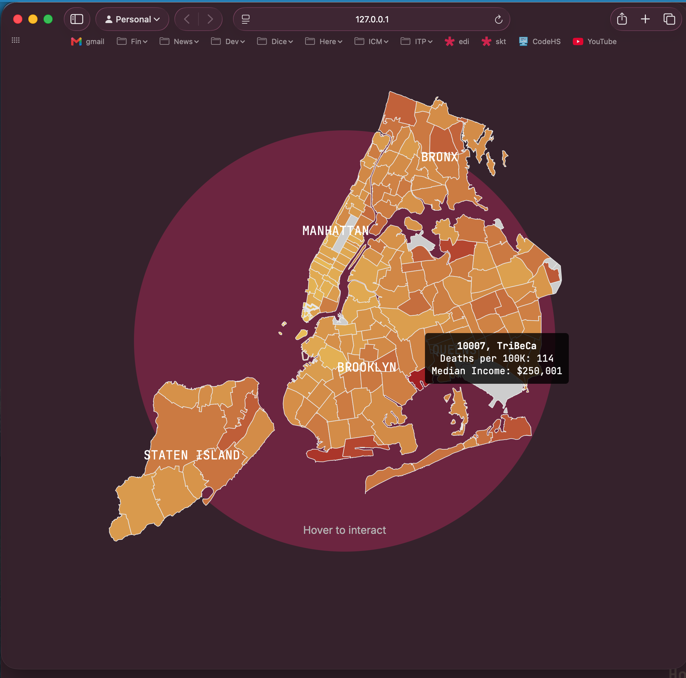

# Log

## 2026-11-03 — Info overlay missing in Chrome

### Prompt

> the overlay hover logic works in Safari
> as capture here
> Log-images/2026-11-03-safari.png
> however it fails to show in Chrome
> use the overlay hover logic from
> ../nyc-map-zhiyang/script.js



### Cause

- **Missing in Chrome:** when you hover over a zip code, `highlightZipcodeArea` moves that shape to the front with `d3.select(target).raise()`. Moving the shape while it's under the cursor makes Chrome send the next mouse-move to the map group around it, not the shape. The path's `mousemove` handler fills in and positions the overlay, so it never ran. Safari keeps sending events to the shape, which is why it worked there. This is the same bug fixed in `../nyc-map-zhiyang`.
- **Wrong place in Safari:** the overlay was inside `#map_container`, which here is `position: relative`, but it was positioned with page coordinates (`e.pageX`, `e.pageY`). So it showed up far from the pointer. In the screenshot, TriBeCa's overlay appears over Queens.

### Fix

Ported from `../nyc-map-zhiyang`:

- [utils.js](utils.js) `highlightZipcodeArea` only moves the shape to the front if it isn't already there:

  ```js
  if (target.parentNode && target.parentNode.lastChild !== target) {
      d3.select(target).raise()
  }
  ```

- [script.js](script.js):
  - `mouseOver` calls `mouseMove.call(this, e)`, so the overlay is filled in and placed right away instead of waiting for the first mouse-move.
  - Overlay placement: it sits beside the pointer, on the right when the pointer is in the left half of the window and on the left in the right half. It's centered vertically on the pointer and kept inside the window.
  - When it switches sides it slides over 0.3s (`tooltipSide`, `tooltipLastMove`, `tooltipSlideTimer`). There's no slide after a pause of more than 300ms.
  - zhiyang's race-distribution table and 400px width were not ported, because this repo has no race data.

Specific to this repo:

- The overlay is now added to `body` instead of `#map_container`, so page coordinates line up. `clearMap()` still removes it, because it selects `.tooltip` anywhere on the page.
- [style.css](style.css): added `text-align: center` to `.tooltip` to keep the centered text it used to get from `#map_container`.

### Verification

- `node --check` passes on `script.js` and `utils.js`.
- Not yet checked in a browser, Chrome or Safari.
